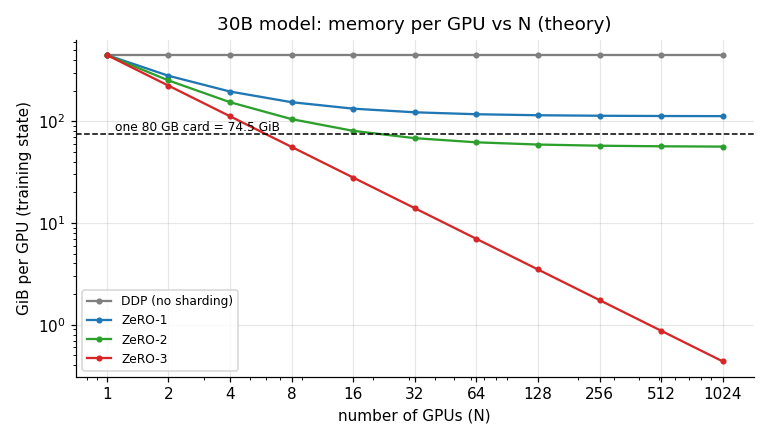
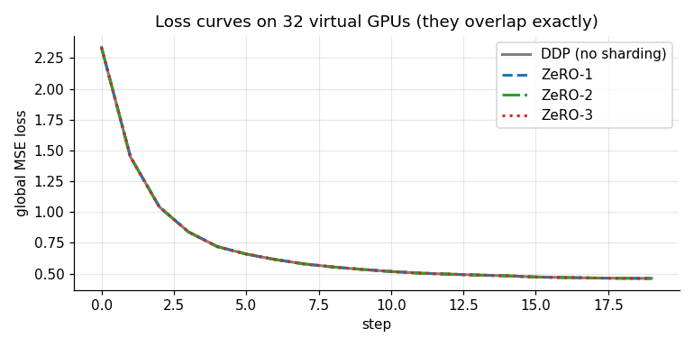
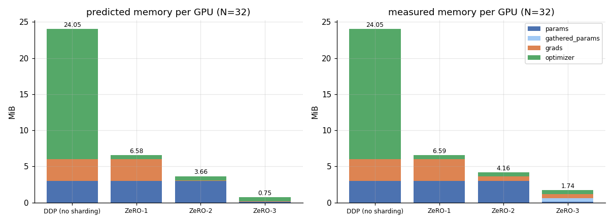
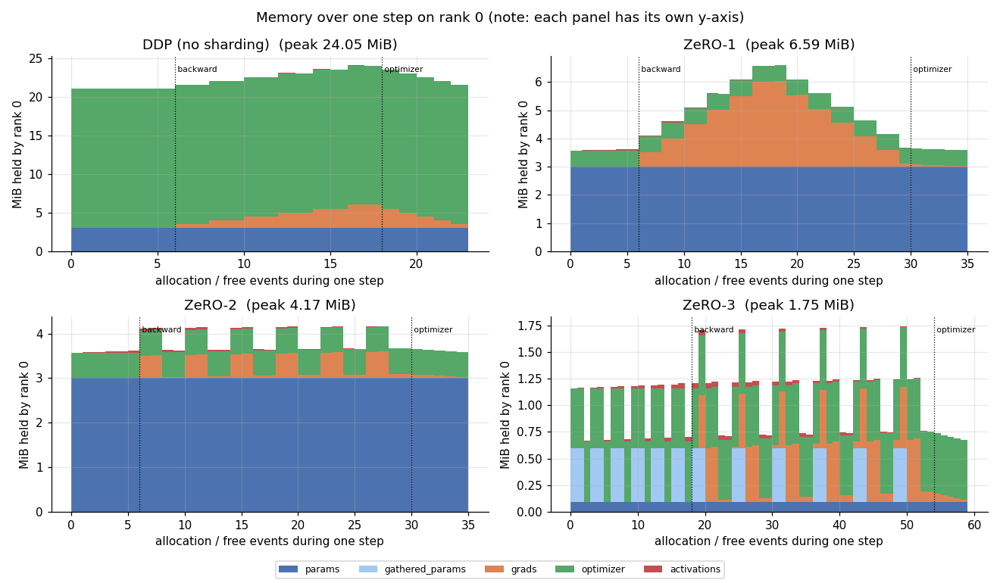
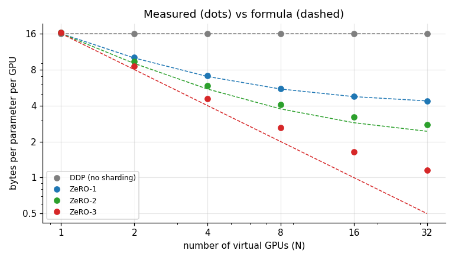
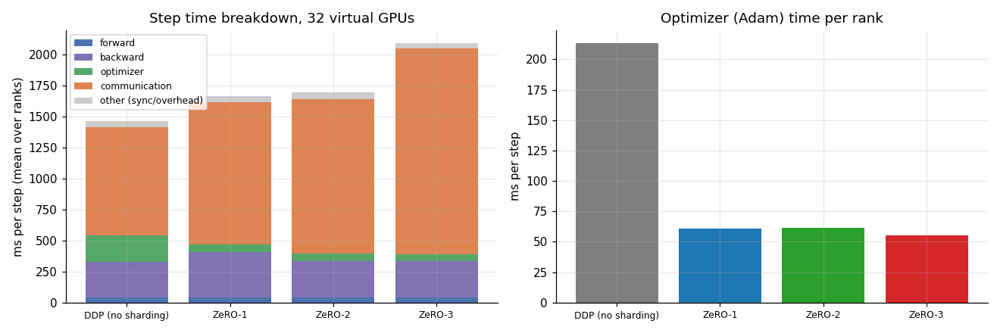

# ZeRO-1, ZeRO-2 and ZeRO-3 on 32 virtual GPUs

ERA V5, Session 12 (Distributed Training I: Data Parallel and ZeRO).

This repo builds a cluster of **32 virtual GPUs** on one laptop, trains a small neural network on it four ways
(plain data parallel, ZeRO-1, ZeRO-2, ZeRO-3), and measures what changes in **memory per GPU**, **communication**
and **computation**.

| | what is split across GPUs | bytes / param per GPU (formula, N=32) | measured | memory vs DDP | communication per step | same weights as DDP? |
|---|---|---|---|---|---|---|
| **DDP** | nothing | 16 | 16.00 | 100% | 1.94 P | yes |
| **ZeRO-1** | optimizer state | 4 + 12/N = 4.375 | 4.39 | 27% | 1.94 P | yes, bit-identical |
| **ZeRO-2** | optimizer state + gradients | 2 + 14/N = 2.44 | 2.77 | 17% | 1.94 P | yes, bit-identical |
| **ZeRO-3** | optimizer state + gradients + weights | 16/N = 0.5 | 1.16 | 7% | 2.91 P | yes, bit-identical |

*(P = the size of one bf16 copy of the weights. "2P" with ring collectives on 32 GPUs is 2 x 31/32 = 1.94 P.
Why ZeRO-2 and ZeRO-3 measure a bit above the formula is explained in [Results](#5-results).)*

---

## Contents

1. [How to run](#1-how-to-run)
2. [The virtual cluster](#2-the-virtual-cluster)
3. [The concepts](#3-the-concepts)
4. [How the code implements each stage](#4-how-the-code-implements-each-stage)
5. [Results](#5-results)
6. [Pros and cons of each stage](#6-pros-and-cons-of-each-stage)
7. [What this simulation does not capture](#7-what-this-simulation-does-not-capture)
8. [Check your understanding](#8-check-your-understanding)
9. [Files](#9-files)

---

## 1. How to run

Requirements: Python 3.10+, PyTorch 2.x (CPU or CUDA build, the GPU is not used), pandas, matplotlib, Jupyter.

```bash
jupyter notebook zero_stages.ipynb      # the full walkthrough with tables and plots
python zero_sim.py --world-size 32      # just the four runs, prints a summary, writes results/results.json
```

The whole notebook takes about 5 minutes on a 6-core laptop CPU.

## 2. The virtual cluster

A real cluster has N GPUs. Each runs one copy of the training program, identified by its **rank** (0 to N-1), and they
talk only through **collective operations** (all-reduce, reduce-scatter, all-gather) over NVLink or InfiniBand.

Here each virtual GPU is **one Python thread** that has:

* its own rank (0 to 31),
* its own model state (a full copy or a slice, depending on the stage),
* its own **gloo** communicator (PyTorch's CPU backend for `torch.distributed`).

Ranks never read each other's tensors. Everything goes through real gloo collectives over loopback TCP, the same API a
multi-machine CPU job would use. Only the main thread looks at all ranks at the end, to check the results.

**Why threads and not 32 processes?** The usual approach is `torch.multiprocessing.spawn` with 32 processes. On Windows,
every process that imports the CUDA build of PyTorch reserves several GB of virtual memory for the CUDA libraries, and 32 of
them filled the page file (`WinError 1455`). Threads share one copy of PyTorch. The assignment allows "CPU threads".

**Why not the GPU?** The laptop has one GTX 1660 Ti. NCCL, the GPU backend, needs one physical GPU per rank, so 32 ranks
can't share it. The model is small enough that the CPU is fine.

**How memory is measured.** All 32 ranks share one OS process, so Task Manager can't tell them apart. Each rank therefore
keeps its own ledger (`MemTracker`): every state tensor is registered when it's created and removed when it's freed, by
category (params, gathered params, grads, optimizer, activations). "Peak" is the most a rank ever held at once.

## 3. The concepts

### 3.1 Why a model needs 16 bytes per parameter

Mixed-precision training with Adam keeps five things for each weight:

| what | dtype | bytes |
|---|---|---|
| the weight used in forward/backward | bf16 | 2 |
| its gradient | bf16 | 2 |
| a master copy of the weight (small updates would be lost to rounding in bf16) | fp32 | 4 |
| Adam's first moment *m* (running average of gradients) | fp32 | 4 |
| Adam's second moment *v* (running average of squared gradients) | fp32 | 4 |
| **total** | | **16** |

The optimizer state (master copy + *m* + *v*) is **12 of the 16 bytes**. A 30B-parameter model needs
30e9 x 16 B = 480 GB = 447 GiB before any activations, about six 80 GB cards' worth.

### 3.2 Data parallelism (DDP)

Every GPU gets a **full copy** of the model and a **different slice of the batch**. After backward, each GPU has a different
gradient (it saw different data). An **all-reduce** sums the gradients so every GPU ends with the same average and applies the
same update, which keeps the copies identical.

Averaging the gradients from 32 GPUs with 8 samples each gives the same update as one GPU with 256 samples. The notebook
checks this: 1 virtual GPU with batch 256 matches 32 virtual GPUs with batch 8 each to within bf16 rounding (3e-3).

The waste: 32 GPUs hold **32 identical copies** of all 16 bytes per parameter, and all 32 run the **same Adam update** on the
same numbers.

### 3.3 The three collectives

| operation | each GPU starts with | each GPU ends with |
|---|---|---|
| **all-reduce** | a full tensor | the full sum |
| **reduce-scatter** | a full tensor | **one slice** (1/N) of the sum |
| **all-gather** | one slice | the full tensor, assembled from everyone's slices |

Key fact: **reduce-scatter followed by all-gather = all-reduce.** A ring all-reduce is implemented as exactly these two
phases. Per GPU, with ring algorithms, for a tensor of S bytes:

* all-reduce sends 2 (N-1)/N x S
* reduce-scatter sends (N-1)/N x S
* all-gather sends (N-1)/N x S

Section 2 of the notebook runs all three on 4 and 32 virtual GPUs and prints what each rank receives.

### 3.4 ZeRO: Zero Redundancy Optimizer

ZeRO (Microsoft, 2019) removes the redundancy. Each of the N GPUs becomes **the owner of 1/N of the parameters** and
keeps the expensive state only for its slice. It fetches anything else just when it's needed. There are three stages, and
each one shards one more kind of state.

With Psi parameters and N GPUs:

| | weights | gradients | optimizer state | bytes / param | communication |
|---|---|---|---|---|---|
| DDP | 2 Psi | 2 Psi | 12 Psi | **16** | 2P |
| ZeRO-1 | 2 Psi | 2 Psi | 12 Psi / N | **4 + 12/N** | 2P |
| ZeRO-2 | 2 Psi | 2 Psi / N | 12 Psi / N | **2 + 14/N** | 2P |
| ZeRO-3 | 2 Psi / N | 2 Psi / N | 12 Psi / N | **16 / N** | 3P |

**ZeRO-1 (shard the optimizer state).** Each GPU keeps the fp32 master copy, *m* and *v* only for its own 1/N slice, so
it also runs Adam only on that slice. After backward the gradients are **reduce-scattered**, so each GPU receives the
averaged gradient for exactly the slice it owns. After the update, each GPU **all-gathers** the new bf16 weights so everyone
has the full model for the next forward. Communication is reduce-scatter + all-gather = the same 2P as DDP's all-reduce.

**ZeRO-2 (also shard the gradients).** A GPU only needs the gradients for the slice it updates. So as soon as a layer's
gradient is computed in backward, it is reduce-scattered and the full-size gradient is freed. Only the 1/N slice is kept.
Communication is still 2P. The only change is *when* the reduce-scatter happens (during backward, bucket by bucket,
instead of after it).

**ZeRO-3 (also shard the weights).** Each GPU stores only 1/N of the weights. Before a layer runs in forward, the GPUs
**all-gather** that layer's weights, compute, and free them straight away. Backward needs the weights again, so there's
a second all-gather per layer. Gradients are reduce-scattered as in ZeRO-2. After the update nothing needs gathering,
because each GPU only keeps its slice. Communication is 2 all-gathers + 1 reduce-scatter = **3P**, 50% more than DDP.
PyTorch's FSDP / FSDP2 is ZeRO-3.

### 3.5 Applied to the 30B V5 model (from the session notes)

| GiB per GPU | 8 GPUs | 16 GPUs | 32 GPUs | 64 GPUs |
|---|---|---|---|---|
| DDP | 447.0 | 447.0 | 447.0 | 447.0 |
| ZeRO-1 | 153.7 | 132.7 | 122.2 | 117.0 |
| ZeRO-2 | 104.8 | 80.3 | **68.1** | 62.0 |
| ZeRO-3 | **55.9** | 27.9 | 14.0 | 7.0 |

An 80 GB card holds 74.5 GiB. DDP and ZeRO-1 **never fit** at any GPU count, because they keep full bf16 weights and
gradients (4 bytes x 30e9 = 111.8 GiB) on every card. ZeRO-2 fits from 32 GPUs and ZeRO-3 from 8.



## 4. How the code implements each stage

`zero_sim.py`, class `Rank`, method `step()`. The model is 6 x `Linear(512, 512)` with ReLU, about 1.58 M parameters.
Each layer's weight and bias live in one flat vector, padded to a multiple of N. Rank r owns elements
`[r*shard, (r+1)*shard)` of every layer. The forward and backward passes are written by hand (no autograd) so that
every gather, reduce and free is visible. A test confirmed they match autograd exactly.

| | forward | backward | after backward | optimizer | after optimizer |
|---|---|---|---|---|---|
| **DDP** | full weights | `all_reduce` each layer's grad as soon as it's ready | | Adam on all params | |
| **ZeRO-1** | full weights | keep full grads | `reduce_scatter` each grad, free the full grads | Adam on my slice | `all_gather` bf16 weights |
| **ZeRO-2** | full weights | `reduce_scatter` each layer's grad straight away, free it | | Adam on my slice | `all_gather` bf16 weights |
| **ZeRO-3** | `all_gather` layer, compute, free | `all_gather` layer, compute grads, free, `reduce_scatter` grad | | Adam on my slice | nothing |

The `Comm` class wraps the gloo calls. It counts bytes with the ring formulas above and times each call. `MemTracker`
does the per-rank memory ledger.

## 5. Results

All numbers below come from the notebook: 32 virtual GPUs, 8 samples per GPU (global batch 256), 20 steps.

### 5.1 All four strategies train the same model



The final fp32 master weights of ZeRO-1, ZeRO-2 and ZeRO-3 are **bit-identical** to DDP (max difference 0.0), and all
DDP / ZeRO-1 / ZeRO-2 replicas of the bf16 weights agree exactly. ZeRO changes **where** state is stored, not **what** is
computed.

### 5.2 Memory per GPU



| | predicted MiB | measured peak MiB | bytes/param measured |
|---|---|---|---|
| DDP | 24.05 | 24.05 | 16.00 |
| ZeRO-1 | 6.58 | 6.59 | 4.39 |
| ZeRO-2 | 3.66 | 4.16 | 2.77 |
| ZeRO-3 | 0.75 | 1.74 | 1.16 |

DDP and ZeRO-1 match the formula. ZeRO-2 and ZeRO-3 are higher because of the **working set**, the part that must exist in
full for a moment:

* **ZeRO-2:** each layer's full gradient exists briefly before it's reduce-scattered. One layer is 1/6 of the model, so
  that's 2 bytes x 1/6 = 0.33 bytes/param. 2.44 + 0.33 = **2.77**, which is what we measured.
* **ZeRO-3:** in backward, a layer's gathered weights (0.33 bytes/param) and its full gradient (0.33) are alive at the same
  time. 0.5 + 0.67 = **1.17**, which matches the measured 1.16.

The formulas describe the *sharded state*. The real peak also includes the largest unit you gather at once. That's why
FSDP wraps models into many small units, and why DeepSpeed exposes bucket sizes. With a 6-layer toy model one unit is a
big fraction. With a 60-layer transformer it would be small.

### 5.3 Memory during one step



* **DDP:** the optimizer state (green) dominates. Gradients (orange) build up layer by layer during backward and are freed after the step.
* **ZeRO-1:** green shrinks to 1/32, but the full gradients still pile up during backward, because they're only reduced at the end.
* **ZeRO-2:** each layer's gradient appears as a spike and is gone immediately. Only the 1/32 slice stays.
* **ZeRO-3:** the light-blue spikes are layers being gathered just in time and thrown away. The resident weights (dark blue) are 1/32 of the model.

### 5.4 Memory as N grows (measured, N = 1 to 32)



At N = 1 all four are the same (16 bytes). As N grows, ZeRO-1 levels off at 4 bytes and ZeRO-2 at 2 bytes, because the
unsharded weights and gradients stay. ZeRO-3 keeps falling, until the gathered-layer working set dominates.

### 5.5 Communication per step

| | collectives per step | measured | textbook |
|---|---|---|---|
| DDP | 6 x all-reduce (grads) | 1.94 P | 2P |
| ZeRO-1 | 6 x reduce-scatter (grads) + 6 x all-gather (weights, after step) | 1.94 P | 2P |
| ZeRO-2 | 6 x reduce-scatter (grads, during backward) + 6 x all-gather (weights) | 1.94 P | 2P |
| ZeRO-3 | 6 x all-gather (fwd) + 6 x all-gather (bwd) + 6 x reduce-scatter | 2.91 P | 3P |

Scaled to the 30B model (P = 60 GB), that's 116 GB per GPU per step for DDP/ZeRO-1/ZeRO-2 and 174 GB for ZeRO-3: about
0.26 s vs 0.39 s over NVLink (450 GB/s), or 2.3 s vs 3.5 s over InfiniBand (50 GB/s).

### 5.6 Computation and time per step



| ms per step (mean over ranks) | forward | backward | optimizer | communication | total |
|---|---|---|---|---|---|
| DDP | 43 | 285 | **213** | 872 | 1461 |
| ZeRO-1 | 39 | 370 | **61** | 1145 | 1662 |
| ZeRO-2 | 44 | 288 | **61** | 1247 | 1695 |
| ZeRO-3 | 39 | 293 | **56** | 1659 | 2090 |

* **Forward/backward compute is the same work in all four.** Every GPU still runs its own 8 samples through the whole model.
  ZeRO splits storage, not compute. The backward differences are noise from 32 threads sharing 12 CPU cores.
* **The optimizer gets about 3.5x cheaper** with any ZeRO stage, because each GPU updates only 1/32 of the parameters. On a GPU
  it would be close to 32x. Here, per-call overhead of 32 Python threads dominates at this tiny size.
* **ZeRO-3 is the slowest:** the extra all-gather pass adds roughly 400 ms here.
* Gloo's reduce-scatter over loopback isn't bandwidth-optimal. It takes about as long as a full all-reduce, so ZeRO-1/2 look
  slower than DDP in wall time even though they send the same bytes. With NCCL on real GPUs, reduce-scatter + all-gather
  costs about the same as one all-reduce. The byte volume carries over to real hardware. These laptop timings don't.

## 6. Pros and cons of each stage

| | pros | cons | use it when |
|---|---|---|---|
| **DDP** | Simplest. Least communication per step. Easy to overlap the all-reduce with backward. | Every GPU holds all 16 bytes/param. The model must fit on one GPU. | The model + optimizer fit comfortably on one GPU. |
| **ZeRO-1** | Removes the biggest block (12 of 16 bytes) for **no extra communication**. The optimizer step gets N times cheaper per GPU. Almost a drop-in change. | Weights and gradients are still replicated (4 bytes/param, regardless of N). Full gradients still pile up in backward. | Always worth it over DDP once the optimizer state hurts. |
| **ZeRO-2** | Also shards gradients, **still no extra communication**. Peak gradient memory is one bucket instead of the whole model. | Gradients must be reduce-scattered during backward, which complicates gradient accumulation. Bucket size becomes a tuning knob. Weights are still replicated (2 bytes/param floor). | The model's weights fit on one GPU but weights + grads + optimizer don't. V4 used this (DeepSpeed stage 2). |
| **ZeRO-3** | Everything is sharded, so memory per GPU keeps falling with N (16/N). It's the only stage that trains a model whose weights alone don't fit on one GPU. | **50% more communication** (3P). Every layer waits on an all-gather, so you need prefetching/overlap or compute stalls. Peak memory also includes the largest gathered unit. More complex to debug. | The model doesn't fit any other way (the 30B V5 model on 8 GPUs). Also when you want fewer GPUs and can hide the extra traffic. |

The rule of thumb: **use the lowest stage that fits**. Each stage up saves memory and costs either complexity (ZeRO-2) or
bandwidth (ZeRO-3). Stages 1 and 2 are nearly free. Stage 3 has a real cost, so it's worth it only when memory forces it.

## 7. What this simulation does not capture

* **No real GPU memory.** Memory is accounted by tensor size per rank. Allocator fragmentation, CUDA context and temporary
  buffers inside matmuls aren't included.
* **No overlap.** Communication here is blocking. Real DDP/FSDP overlap gradient reduction with backward and prefetch the
  next layer's weights in ZeRO-3. That's why the time chart shows communication stacked on top of compute.
* **Loopback TCP, not NVLink.** Absolute times are meaningless for real hardware. Bytes per step are the transferable number.
* **Tiny activations.** With 8 samples x 512 features, activations are KBs. In real LLM training they're often the largest
  item and need activation checkpointing. ZeRO doesn't shard activations.
* **No offload.** ZeRO-Offload / Infinity (moving optimizer state to CPU RAM or NVMe) isn't simulated.

## 8. Check your understanding

<details><summary>Why does ZeRO-1 cost no extra communication compared with DDP?</summary>
DDP's all-reduce is internally a reduce-scatter plus an all-gather. ZeRO-1 does the same two phases. It just runs the
optimizer between them, on the slice it received from the reduce-scatter, and all-gathers the updated weights instead of
the gradients.
</details>

<details><summary>Why can't DDP or ZeRO-1 fit the 30B model on any number of 80 GB GPUs?</summary>
Both keep a full bf16 copy of the weights (2 bytes) and of the gradients (2 bytes) on every GPU. 4 x 30e9 bytes = 111.8 GiB,
which is more than 74.5 GiB, and adding GPUs doesn't shrink it.
</details>

<details><summary>Where does ZeRO-3's extra 1P come from?</summary>
The weights are sharded, so they must be all-gathered before forward. Freeing them after use is the whole point, so they
must be all-gathered again for backward. That's 2 all-gathers (2P) plus the gradient reduce-scatter (1P).
</details>

<details><summary>Why did ZeRO-3 measure 1.16 bytes/param instead of 0.5?</summary>
In backward, one layer's gathered weights and its full gradient are both alive at once. Each is 2 bytes x 1/6 of the
model = 0.33 bytes/param, so 0.5 + 0.67 = 1.17. With many small layers this overhead shrinks.
</details>

<details><summary>Does ZeRO reduce compute per GPU?</summary>
Forward and backward: no, every GPU still processes its own micro-batch through the full model. Optimizer: yes, each
GPU only updates 1/N of the parameters.
</details>

## 9. Files

| file | what it is |
|---|---|
| `zero_stages.ipynb` | the walkthrough notebook: theory, collectives demo, the four runs, plots and tables |
| `zero_sim.py` | the simulator: virtual cluster, hand-written MLP, DDP / ZeRO-1 / ZeRO-2 / ZeRO-3, memory and comm accounting |
| `results/` | figures, `results_32gpu.json` (all measurements) and `summary.csv` |
